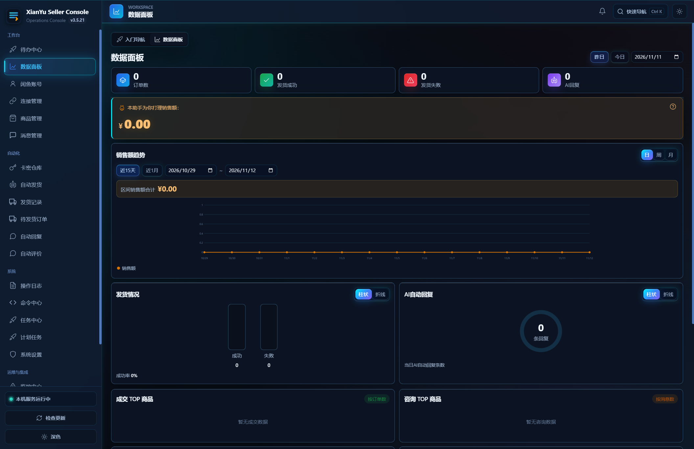

# 闲鱼卖家运营控制台

> 面向自有闲鱼账号的本地化运营工具：统一管理账号、商品、消息、发货、库存与自动化任务。

[](LICENSE)
[](https://github.com/yuchen0x1/Xianyu-Assistant/releases)

当前版本：**v3.5.24** · [GitHub 仓库](https://github.com/yuchen0x1/Xianyu-Assistant) · [更新日志](CHANGELOG.md)

## 项目简介

本项目仅提供网页版，电脑和手机均通过浏览器访问。JAR 与 Docker 用于部署同一个 Web 服务，不提供 Android/iOS App 或独立桌面客户端。

「闲鱼卖家运营控制台」历史名称为「闲鱼自动发货助手」，是一套部署在自己电脑或服务器上的卖家运营工具。它将账号连接、商品资料、消息处理、自动回复、自动发货、卡密库存、任务调度、Webhook、备份和监控集中到一个控制台中。

核心数据默认保存在本地 SQLite，不依赖本项目提供的第三方业务服务器。AI、邮件、Webhook、代理池等能力是否启用，由你的配置决定。

## 产品预览

<p align="center">
  
</p>

<p align="center"><em>账号、商品、消息与自动化任务集中管理的本地化运营控制台。</em></p>

> **使用边界**：请仅用于你有权管理的账号和数据，并遵守闲鱼及相关第三方服务的用户协议、隐私政策和适用法律。本项目不鼓励绕过平台安全机制或实施滥发、欺诈等违规行为。

## 最新更新

### v3.5.24（2026-11-13）

- Webhook 现在可以查看投递历史，按状态筛选，直接了解失败原因、累计尝试次数和下次重试时间。
- 修复“全部事件”配置不生效、成功后仍显示旧错误，以及后台投递覆盖刚修改配置的问题。
- 减少重复投递，明确重试停止状态；保存和测试提供等待反馈，历史列表适配手机屏幕。

逐版变化、升级影响与历史档案见 [发布记录](docs/releases/release-notes.md)，使用说明见 [Webhook 投递与排障](docs/webhook-delivery.md)。

## 技术栈与部署形态

| 组件 | 技术 / 说明 |
| --- | --- |
| 后端 | Java 21、Spring Boot 3.5、MyBatis-Plus、SQLite、WebSocket、Playwright、OkHttp、JJWT、EasyExcel |
| Web 前端 | Vue 3.5、TypeScript、Vite、Vitest |
| AI | Spring AI，支持 OpenAI 兼容接口；默认配置指向 DashScope 兼容接口 |
| 可观测性 | Spring Boot Actuator、Micrometer、Prometheus |
| 部署 | 官方 Release JAR、源码构建 JAR、Docker、本机开发、systemd + Nginx |
| 数据 | 本地 SQLite，默认位于 `dbdata/` |
| 许可证 | Apache License 2.0 |

## 核心能力

### 账号与连接

- 扫码登录、本机浏览器登录接管、手动添加 Cookie、多账号并行管理。
- Cookie / Token 管理、WebSocket 长连接、心跳保活、自动重连和连接健康状态。
- 账号级风控事件记录，以及异常后的自动暂停与冷却。

### 商品与发布

- 商品同步、本地资料编辑、SKU 管理、价格历史和状态筛选。
- 商品发布模板 CRUD、CSV 批量导入和模板批量上架。
- 商品擦亮：单品一键擦亮、账号在售批量擦亮，支持 Cron 定时自动擦亮获取平台免费曝光。

### 消息与 AI

- 会话列表、历史消息、文字 / 图片回复、人工接管和关键词回复。
- 延时回复、AI 回复、知识库上下文（RAG）、AI 回复人工确认。
- 智能议价：保底价、让价步长和轮数限制；AI 不可用时可降级为规则话术。

### 发货与卡密

- 文本、图片、卡密和自定义内容发货。
- 失败重试、库存预占与回滚、按账号配置的发货风控规则。
- 可选的断线后 API 兜底发货（默认关闭）。
- 卡密批量导入、库存管理、预占 / 发放、使用记录和低库存告警。
- 发货流水、状态筛选和 Excel 导出。

### 自动化与集成

- 任务定义、幂等执行、失败重试与退避、死信队列和补偿任务。
- 自动评价调度、人工确认 / 取消 / 重试和评价记录观察；平台能力未接入时会转人工处理，不伪造成功状态。
- Cron 计划任务管理，支持启停和失败恢复。
- 命令中心内置 6 个自动化命令，并提供 `/api/mcp` JSON-RPC 2.0 端点，可将内置命令作为 AI 工具调用。
- Webhook 事件推送、HMAC-SHA256 签名、投递历史持久化、指数退避重试和 SSRF 防护。
- 监控中心：健康概览、告警持久化 / 去重 / 抑制、确认 / 静默 / 恢复状态机。

### 数据与安全

- 商品、订单、消息、发货成功率、AI 回复等运营数据统计与可视化。
- 登录限流、RBAC 权限、敏感凭据加密落库和操作日志审计。
- 全量备份与恢复、Excel 导出、健康检查、Prometheus 指标、多渠道通知和在线更新检查。

### 界面

- 深空赛博主题：霓虹电光青 / 赛博蓝 / 电离紫三色光效体系，深色高精悬浮磨砂玻璃。
- 矩阵微光点阵背景、流光扫过按钮、卡片悬浮升维辉光、雷达呼吸状态灯与霓虹能量条导航。
- 尊重 `prefers-reduced-motion` 与 `prefers-reduced-transparency`：系统开启减弱动效或减弱透明时自动降级为静态纯色界面。

## 快速开始

### 选择部署方式

| 方式 | 适合场景 | 需要准备 |
| --- | --- | --- |
| Docker | 生产容器、希望自动构建前后端 | Docker 20.10+ |
| 官方 Release + `install.sh` | Linux / macOS / Termux 快速安装 | Java 21；脚本可协助安装 |
| Windows 开发脚本 | 本地开发和调试 | Java 21、Node.js |
| 源码构建 JAR | 自定义构建或二次开发 | Java 21、Node.js |

默认后端端口为 `12400`，默认只监听本机地址。首次启动时，在数据库为空的情况下，页面会显示注册表单，第一个注册账号绑定 `ADMIN` 角色。

### 方式一：Docker

仓库没有预构建 Docker 镜像；使用仓库内的多阶段 `Dockerfile` 本地构建：

```bash
docker build -t xianyu-seller-console:local .
docker run -d \
  --name xianyu-seller-console \
  -p 127.0.0.1:12400:12400 \
  -v "$(pwd)/dbdata:/app/dbdata" \
  xianyu-seller-console:local
```

容器使用 Java 21 运行时，默认将应用绑定到 `0.0.0.0:12400`，并将 `dbdata/` 挂载到容器内 `/app/dbdata`。容器场景保持 `XIANYU_ASSISTANT_SELF_UPDATE_RESTART_MODE=exit`，由 Docker 重启策略负责拉起进程。

### 方式二：官方 Release + 一键安装

```bash
curl -fsSLO https://raw.githubusercontent.com/yuchen0x1/Xianyu-Assistant/main/install.sh
bash install.sh
```

安装脚本从 GitHub Release 获取最新 JAR，并校验 SHA-256 与官方 Ed25519 签名。默认安装目录为 `~/xianyu-seller-console`，端口可通过 `PORT` 环境变量覆盖。

当前 v3.5.24 资产：

- [XianYuSellerConsole-3.5.24.jar](https://github.com/yuchen0x1/Xianyu-Assistant/releases/download/v3.5.24/XianYuSellerConsole-3.5.24.jar)
- [XianYuSellerConsole-3.5.24.jar.sha256](https://github.com/yuchen0x1/Xianyu-Assistant/releases/download/v3.5.24/XianYuSellerConsole-3.5.24.jar.sha256)
- [XianYuSellerConsole-3.5.24.jar.sig](https://github.com/yuchen0x1/Xianyu-Assistant/releases/download/v3.5.24/XianYuSellerConsole-3.5.24.jar.sig)

以上 JAR 是网页版的服务端安装包，启动后在浏览器中访问；手机直接访问同一个 Web 地址。

### 方式三：Windows 本地开发

```powershell
.\mvnw.cmd -B -ntp -DskipTests package
cd vue-code
npm ci
cd ..
.\scripts\start-dev.ps1
```

开发脚本会检查端口占用，并在前端退出时停止后端：

- 后端默认：`127.0.0.1:12400`
- 开发前端默认：`127.0.0.1:5180`
- 单独运行 `npm run dev` 时，Vite 默认端口来自 `vue-code/vite.config.ts`（当前为 `5173`）
- 停止开发环境：`.\scripts\stop-dev.ps1`
- 自定义端口：`.\scripts\start-dev.ps1 -FrontendPort 5181 -BackendPort 12401`

> PowerShell 示例中的路径使用 Windows 反斜杠；如果复制上面的命令，请确认 `scripts` 路径为 `.\scripts\...`。

### 方式四：从源码构建 JAR

前端构建产物不提交到仓库。源码手工打包前，必须先构建前端：

```bash
cd vue-code
npm ci
npm run build
cd ..
./mvnw -B -ntp -DskipTests clean package
java -jar target/XianYuSellerConsole-*.jar
```

使用官方 Release JAR 或 Docker 时无需重复构建前端，因为对应产物已包含静态页面。

## 开发环境与验证

### 环境要求

- Java 21（后端和 JAR 运行必需）
- Node.js `20.19+` 或 `22.12+`（前端构建）
- Docker 20.10+（仅容器部署）

### 分项检查

```bash
# 后端
./mvnw --batch-mode --no-transfer-progress test

# 前端
cd vue-code
npm ci
npm test
npm run type-check
npm run build
cd ..
```

Windows 可运行统一验收脚本：

```powershell
.\scripts\check-project.ps1
```

验收脚本只检查 Web 前端和服务端，不会删除或覆盖 `dbdata/`。

## 生产部署、自动更新与升级

生产环境的 systemd、Nginx、GitHub Actions 部署、健康检查和回退步骤见：[生产部署说明](docs/production-deployment.md)；自动更新的实现、配置、发布和验证见：[自动更新说明](docs/AUTO_UPDATE.md)。

### systemd 自动重启

默认自更新策略为 `exit`：应用完成 JAR 替换后退出，由外部进程管理器重新拉起。因此 systemd 服务至少需要：

```ini
[Service]
Restart=always
RestartSec=5
```

如果使用裸 `nohup java -jar`，可以改用 `XIANYU_ASSISTANT_SELF_UPDATE_RESTART_MODE=self`；不要将 `self` 与 Docker 或其他外部重启策略同时启用。

### 应用内自动更新

v3.5.17 起，应用内定时自动更新默认开启：

1. 启动约 5 分钟后首次检查官方 GitHub Release。
2. 默认每 6 小时检查一次。
3. 下载后校验 SHA-256 与 Ed25519 签名。
4. 通过原子替换更新 JAR，失败时回滚。
5. 按 `restart-mode` 决定退出、自拉起或等待人工重启。

关闭自动更新：

```bash
export XIANYU_ASSISTANT_AUTO_UPDATE_ENABLED=false
```

自动更新与手动在线更新共用更新状态机，同一时间只允许一个更新流程执行。完整配置见下方环境变量表和 `docs/production-deployment.md`。

### 从 v3.5.23 升级

- 推荐使用应用内在线更新、自动更新或重新执行 `bash install.sh`。
- 升级前备份 `dbdata/`，尤其是 SQLite 数据库、JWT 密钥和凭据密钥文件。
- 使用默认 `exit` 模式时，确认 systemd / Docker / 守护循环具备自动重启能力。
- v3.5.24 不新增数据库迁移；从更早版本升级时仍会执行既有增量迁移，保留业务数据。
- 旧的单段自动发货配置继续可用；模板发货支持在后台按商品或 SKU 绑定后启用。
- 不需要自动更新时设置 `XIANYU_ASSISTANT_AUTO_UPDATE_ENABLED=false`。

## 配置参考

完整配置和默认值见 [`src/main/resources/application.yaml`](src/main/resources/application.yaml)。下面列出部署时最常用的变量。

### 网络、登录与数据

| 环境变量 | 默认值 | 说明 |
| --- | --- | --- |
| `XIANYU_ASSISTANT_BIND_ADDRESS` | `127.0.0.1` | 监听地址；设为 `0.0.0.0` 才开启局域网访问 |
| `XIANYU_ASSISTANT_JWT_SECRET` | 空，自动生成 | 生产环境建议设置至少 32 字节随机值 |
| `XIANYU_ASSISTANT_JWT_SECRET_FILE` | `dbdata/jwt-secret.key` | JWT 密钥持久化文件 |
| `XIANYU_ASSISTANT_BACKUP_ENABLED` | `true` | 自动备份开关 |
| `XIANYU_ASSISTANT_BACKUP_INTERVAL_MS` | `43200000` | 自动备份间隔，默认 12 小时 |
| `XIANYU_ASSISTANT_BACKUP_DIRECTORY` | `dbdata/backups` | 备份目录 |
| `XIANYU_ASSISTANT_BACKUP_RETENTION_COUNT` | `14` | 备份保留份数 |

### 更新

| 环境变量 | 默认值 | 说明 |
| --- | --- | --- |
| `XIANYU_ASSISTANT_UPDATE_CHECK_ENABLED` | `true` | 是否检查在线更新 |
| `XIANYU_ASSISTANT_UPDATE_GITHUB_REPOSITORY` | `yuchen0x1/Xianyu-Assistant` | GitHub Release 仓库 |
| `XIANYU_ASSISTANT_SELF_UPDATE_ENABLED` | `true` | 是否允许应用内替换 JAR |
| `XIANYU_ASSISTANT_SELF_UPDATE_RESTART_MODE` | `exit` | `exit`、`self` 或 `manual` |
| `XIANYU_ASSISTANT_AUTO_UPDATE_ENABLED` | `true` | 是否启用定时自动更新 |
| `XIANYU_ASSISTANT_AUTO_UPDATE_CHECK_INTERVAL_MS` | `21600000` | 自动更新检查间隔，默认 6 小时 |
| `XIANYU_ASSISTANT_AUTO_UPDATE_INITIAL_DELAY_MS` | `300000` | 启动后首次检查延迟，默认 5 分钟 |

### AI、发货与出站请求

| 环境变量 | 默认值 | 说明 |
| --- | --- | --- |
| `XIANYU_ASSISTANT_API_DELIVERY_FALLBACK_ENABLED` | `false` | 是否启用 API 兜底发货 |
| `XIANYU_ASSISTANT_API_DELIVERY_FALLBACK_ACCOUNT_IDS` | 空 | 允许使用 API 兜底发货的账号 ID |
| `XIANYU_ASSISTANT_IMAGE_DOWNLOAD_ALLOWED_HOSTS` | `alicdn.com,goofish.com` | URL 代传图片允许的可信域名 |
| `XIANYU_ASSISTANT_AI_CONNECT_TIMEOUT_SECONDS` | `5` | AI 连接超时 |
| `XIANYU_ASSISTANT_AI_RESPONSE_TIMEOUT_SECONDS` | `35` | AI 响应超时 |
| `XIANYU_ASSISTANT_TOKEN_REFRESH_POOL_SIZE` | `2` | Cookie 保活线程池大小 |

默认后端端口为 `12400`，默认只监听本机；AI 未配置 API Key 时，AI 能力会降级，关键词回复等非 AI 功能不受影响。

## 数据与安全

- SQLite 数据库、自动备份和运行数据默认位于 `dbdata/`；请将该目录纳入备份策略。
- Cookie、Token、AI 密钥、SMTP 密码和通知渠道密钥落库时使用 AES/GCM 加密，日志会做脱敏。
- JWT 密钥默认写入 `dbdata/jwt-secret.key`；生产环境建议通过 `XIANYU_ASSISTANT_JWT_SECRET` 显式配置并妥善保管。
- Webhook 地址只允许 HTTP / HTTPS，并校验解析后的 IP，阻断本机、环回和内网目标；图片 URL 代传受可信域名限制。
- 登录接口具备 IP 限流；请勿把 Cookie、密钥或生产数据库提交到 Git、截图或公开群组。
- 漏洞报告流程见 [`SECURITY.md`](SECURITY.md)，安全设计记录见 [`docs/security-architecture-2026-09.md`](docs/security-architecture-2026-09.md)。

## 文档导航

| 文档 | 内容 |
| --- | --- |
| [`docs/production-deployment.md`](docs/production-deployment.md) | systemd、Nginx、自动部署、自动更新与回退 |
| [`docs/local-browser-login.md`](docs/local-browser-login.md) | 本机浏览器登录接管 |
| [`docs/multi-account-onboarding-2026-08-21.md`](docs/multi-account-onboarding-2026-08-21.md) | 多账号接入与并行验证 |
| [`CHANGELOG.md`](CHANGELOG.md) | 完整版本历史 |
| [`RELEASE_NOTES_CN.md`](RELEASE_NOTES_CN.md) | GitHub 正式版本逐版中文说明 |
| [`RELEASE_NOTES_EN.md`](RELEASE_NOTES_EN.md) | GitHub 正式版本逐版英文说明 |
| [`SECURITY.md`](SECURITY.md) | 漏洞报告与安全政策 |

## 常见问题

### 首次启动后如何创建账号？

数据库为空时，访问 Web 控制台会显示注册表单。第一个注册账号绑定 `ADMIN` 角色；已有账号后页面切换为登录表单。

### `start-dev.ps1` 提示 `Backend jar is missing` 怎么办？

先生成后端 JAR，并确认前端依赖已安装：

```powershell
.\mvnw.cmd -B -ntp -DskipTests package
cd vue-code
npm ci
```

### 端口被占用怎么办？

开发脚本会提示占用端口的进程并退出。可以指定其他端口：

```powershell
.\scripts\start-dev.ps1 -FrontendPort 5181 -BackendPort 12401
```

### 登录提示“登录错误次数过多”怎么办？

连续登录失败会触发 IP 限流，等待限流窗口结束后再重试。不要通过反复刷新或脚本化请求绕过限制。

### AI 回复不可用怎么办？

在系统设置中配置 AI API Key 和对应接口地址。默认使用 DashScope 兼容接口；未配置时 AI 功能会自动降级，关键词回复不受影响。

### 页面提示检查更新失败怎么办？

更新检查依赖 GitHub Release API。Release 不存在、网络不可达或 GitHub API 暂时不可用时会失败，但不影响其他功能；也可以使用本地 JAR 或 `install.sh` 手动升级。

### JAR 启动后页面空白怎么办？

源码手工部署时必须先构建前端，因为 `src/main/resources/static/` 不入库：

```bash
cd vue-code && npm ci && npm run build
cd .. && ./mvnw -B -ntp -DskipTests clean package
```

官方 Release JAR 和 Docker 构建产物已包含前端页面。

## 项目目录

```text
src/main/java/com/feijimiao/xianyuassistant/  # 后端源码
src/main/resources/                           # 应用配置与资源
vue-code/                                     # Vue 3 + TypeScript 前端
scripts/                                      # Windows 开发与验收脚本
docs/                                         # 部署、登录和运维文档
dbdata/                                       # SQLite、密钥和备份（运行时生成）
install.sh                                    # Linux/macOS/Termux 安装脚本
Dockerfile                                    # 前端 → 后端 → 运行时多阶段构建
.github/workflows/                            # CI、Release 和生产部署流水线
CHANGELOG.md                                  # 更新日志
LICENSE                                       # Apache-2.0 许可证
```

## 二次开发声明

本项目是 [`IAMLZY2018/XianYuAssistant`](https://github.com/IAMLZY2018/XianYuAssistant) 的二次开发版本，与上游项目不是同一个发布仓库。上游原作者为 `IAMLZY2018`，原始项目同样采用 Apache-2.0 协议。

在上游基础上，本仓库持续维护和扩展了包括以下内容：

- 闲鱼协议适配层与接口失效降级
- 商品发布模板、CSV 批量导入和批量上架
- AI 回复人工确认模式
- Excel 导出、RBAC、任务引擎和死信队列
- Webhook 事件推送与 SSRF 防护
- 数据自动备份与恢复、代理池、API 兜底发货
- 操作日志审计、监控告警和在线更新

使用和再分发时请保留上游版权声明、本说明和 [`LICENSE`](LICENSE)。

## Star History

<a href="https://star-history.com/#yuchen0x1/Xianyu-Assistant&Date">
  <picture>
    <source media="(prefers-color-scheme: dark)" srcset="https://api.star-history.com/svg?repos=yuchen0x1/Xianyu-Assistant&type=Date&theme=dark">
    
  </picture>
</a>

## 反馈与交流

- QQ 交流群：`1016190748`
- Telegram：<https://t.me/lenmoC>
- GitHub Issues：<https://github.com/yuchen0x1/Xianyu-Assistant/issues>

反馈问题时请注明版本、运行平台、部署方式和具体现象；涉及上游代码时，请同时说明上游项目地址与原作者信息。

## 许可证

本项目沿用 Apache License 2.0，详见 [`LICENSE`](LICENSE)。
